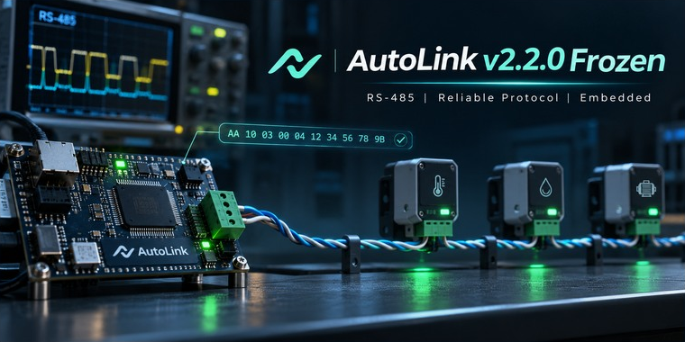
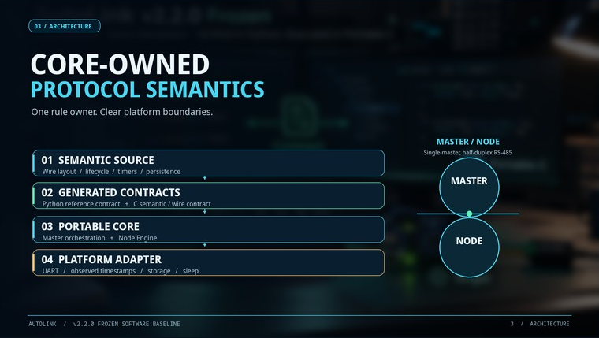
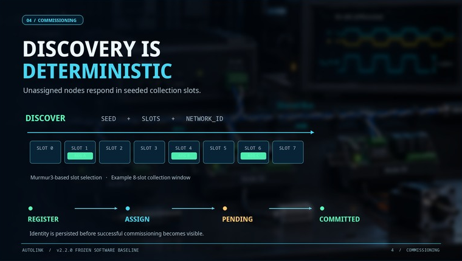
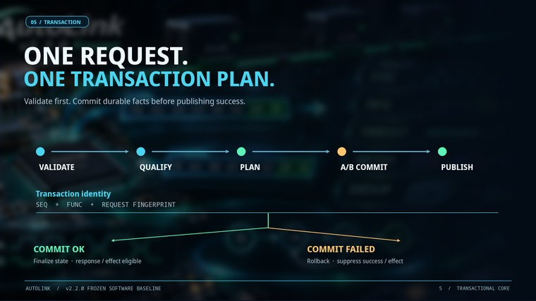
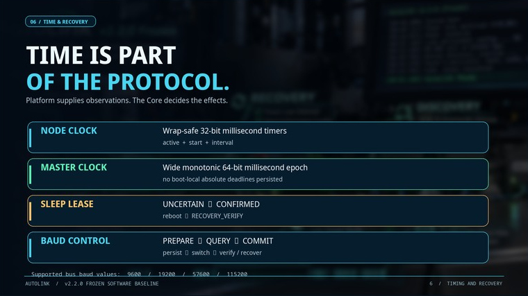
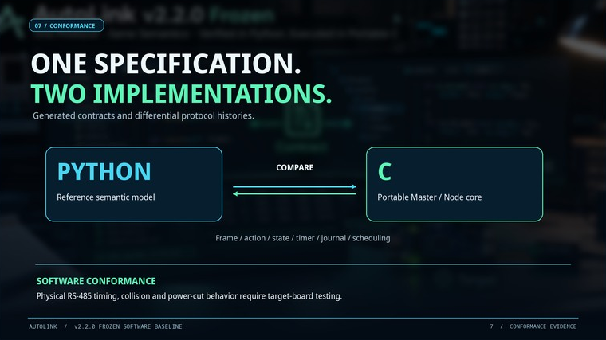

# AutoLink v2.2.0

AutoLink 是面向嵌入式设备的**单主多从、半双工 RS-485 通信协议栈**。主站发现并管理总线节点，节点可上报传感器数据、接受配置，并按协议处理重复请求、重启恢复和波特率切换。协议核心用 C 实现，串口、时间和存储由设备适配层接入。

图片用于说明设计。总线帧、接口和状态转换以源码与协议规范为准。

## 快速上手

| 目标 | 入口 |
| --- | --- |
| 把 AutoLink 接入自己的主站和节点 | [库集成与快速上手](AutoLink-v2.2.0-Library-Integration-Guide.md) |
| 核对可调用的接口、回调顺序和错误语义 | [公开 API](AutoLink-v2.2.0-Public-Integration-API.md) · [JSON 接口清单](GrainSilo-AutoLink-v2.2.0-API-Allowlist.json) |
| 实现兼容的节点或解析总线数据 | [协议规范](docs/spec/AUTOLINK-V2.2-SPEC.md) · [状态机](docs/spec/STATE-MACHINES.md) · [生成的协议表](docs/spec/generated-spec-tables.md) |
| 查看 ESP32-S3、ESP32-C3 与 SHT31 的完整用法 | [GrainSilo 集成与编译说明](https://github.com/sun2006-xin/grainsilo/tree/main/firmware) |

## 架构与帧格式

`AutoLinkCore` 管理 Master 与 Node 的状态、请求处理、计时和持久化。应用通过接口提供传感器与配置操作，平台适配层负责 UART、RS-485 方向切换、单调时钟和存储。 `GSProto` 负责帧编解码与 CRC。

线上帧为 `VER | ADDR | SEQ | FUNC | LEN | DATA | CRC16-LE`。数据最多 247 字节，完整帧最多 254 字节。CRC 使用 Modbus CRC-16 算法，命令与状态机由 AutoLink 规范定义。

## 节点发现与入网

主站发送带种子和时隙数的 `DISCOVER`。符合条件的未分配节点按 Murmur3 算出应答时隙，发送 `REGISTER`。收到 `ASSIGN` 后，节点先将地址和网络身份持久化为 `PENDING`，再发 `REG_CONFIRM`。随后，对候选地址的一次符合条件且正常完成的事务可将状态推进到 `COMMITTED`。发现、状态确认和恢复的细节见 [协议规范](docs/spec/AUTOLINK-V2.2-SPEC.md)。

## 重复请求与持久化

带副作用的普通事务按序号、功能码和请求指纹识别。缓存有效期内，完全相同的请求可以复用已完成的结果。同一序号配上不同功能码或请求内容时会返回冲突。涉及持久化的状态变更由核心构造事务计划并提交到双槽日志，提交成功后才允许发布对应的成功响应或硬件效果。

## 计时、休眠与波特率切换

Node 使用可处理回绕的 32 位毫秒计时，Master 使用较宽的单调时间。平台上报 UART 收发时刻，核心按状态和时间决定何时调度响应、发布休眠效果或发起波特率切换。支持 9600、19200、57600 和 115200。波特率切换包含准备、查询、提交、切换后验证以及必要时的扫描恢复。

## 源码与验证

- `spec/` 存放声明式协议源，`generated/` 存放 C/Python 集成使用的生成契约与测试向量。
- `libraries/AutoLinkCore/` 与 `libraries/GSProto/` 是可安装的源码库，`docs/spec/` 提供协议文档。
- 安装 Python 3 和受支持的 C 编译器后，在仓库根目录运行 `python tools/run_c_tests.py`。测试覆盖请求处理、持久化恢复、Master 调度和接口边界。实物 RS-485 时序、碰撞与断电恢复需在目标板上测量。

冻结基线源提交为 `d2dfc291ba6bd5c24b9f1c34d3558096597d7e41`。GrainSilo 应用集成见 [GrainSilo Smart Probe](https://github.com/sun2006-xin/grainsilo)。

协议文档及代码按 [Apache-2.0](LICENSE) 发布。首页概念图由项目提供，图像和品牌标识不在软件许可范围内。
