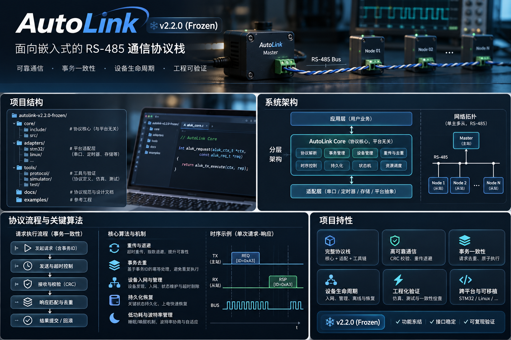

# AutoLink v2.2.0

AutoLink 是面向嵌入式设备的单主多从 RS-485 通信协议栈。此仓库发布冻结基线的协议规范、可移植 C 核心和生成的 C/Python 协议契约。

上图是项目概念示意。实际目录、API、帧格式及状态机以本仓库源码和规范为准。

## 从这里开始

- [协议规范](docs/spec/AUTOLINK-V2.2-SPEC.md)与[状态机](docs/spec/STATE-MACHINES.md)
- [库集成指南](AutoLink-v2.2.0-Library-Integration-Guide.md)与[公开 API](AutoLink-v2.2.0-Public-Integration-API.md)
- `libraries/AutoLinkCore` 提供 Master、Node、计时和持久化逻辑。帧编解码及校验由 `libraries/GSProto` 提供。
- `spec/` 和 `generated/` 保存语义源和生成契约。应用适配层负责串口、时钟与持久化介质。
- 运行 `python tools/run_c_tests.py` 可使用受支持的本机 C 编译器执行随附的核心测试。RS-485 实物时序、碰撞和断电恢复需在目标板上单独测量。

冻结基线源提交为 `d2dfc291ba6bd5c24b9f1c34d3558096597d7e41`。GrainSilo 应用集成见 [GrainSilo Smart Probe](https://github.com/sun2006-xin/grainsilo)。

协议文档及代码按 [Apache-2.0](LICENSE) 发布。首页概念图由项目提供，图像和品牌标识不在软件许可范围内。
