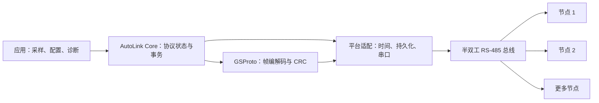
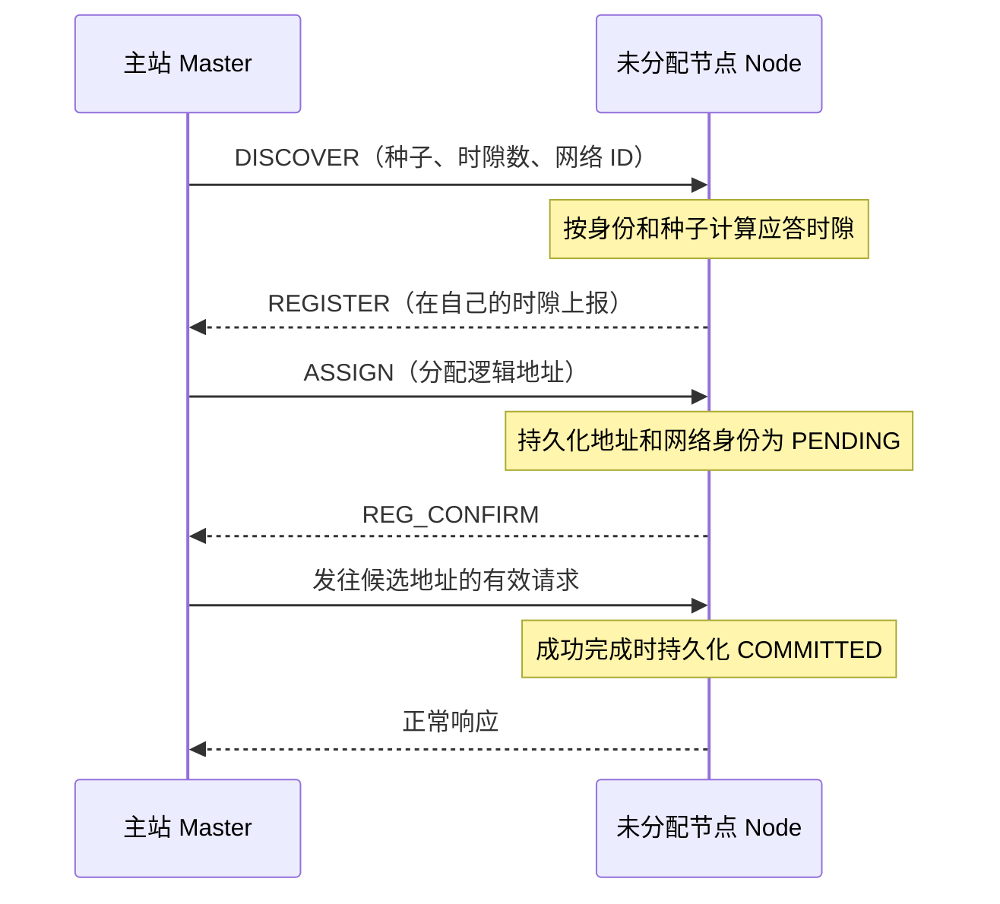

<p align="center">
  
</p>

<h1 align="center">AutoLink 嵌入式通信协议栈</h1>
<p align="center"><strong>AutoLink v2.2.0 · RS-485 Protocol Stack</strong></p>
<p align="center">节点自动接入 · 可靠事务 · 断电恢复 · 可移植 C 核心</p>
<p align="center">
  
  
  
  
  
  
</p>

> AutoLink 提供协议规范、可移植 C 实现与集成指南。[GrainSilo 粮仓探杆](https://github.com/sun2006-xin/grainsilo)是 ESP32-S3 主站与 ESP32-C3 测量节点的应用实例。图片展示的是网络概念；帧字段、接口和状态转换以源码与协议规范为准。

## 项目简介

AutoLink 是面向嵌入式设备的**单主站、多节点、半双工 RS-485 通信协议栈**。它负责新节点发现、逻辑地址分配、按地址读写、重复请求处理，以及节点重启、持久化、休眠与波特率恢复。协议核心使用可移植 C，串口、收发方向、时钟和非易失存储由目标设备接入。

仓库包含协议规范、C 实现、Python 语义参考、生成的契约和主机端验证工具。AutoLink 管通信，传感器测量与温湿度预测由应用实现。

## 快速上手

| 目标 | 入口 |
| --- | --- |
| 把 AutoLink 接入自己的主站和节点 | [库集成与快速上手](AutoLink-v2.2.0-Library-Integration-Guide.md) |
| 核对可调用的接口、回调顺序和错误语义 | [公开 API](AutoLink-v2.2.0-Public-Integration-API.md) · [JSON 接口清单](GrainSilo-AutoLink-v2.2.0-API-Allowlist.json) |
| 实现兼容的节点或解析总线数据 | [协议规范](docs/spec/AUTOLINK-V2.2-SPEC.md) · [状态机](docs/spec/STATE-MACHINES.md) · [生成的协议表](docs/spec/generated-spec-tables.md) |
| 查看 ESP32-S3、ESP32-C3 与 SHT31 的完整用法 | [GrainSilo 集成与编译说明](https://github.com/sun2006-xin/grainsilo/tree/main/firmware) |

## 架构与帧格式




一个网络中由 **Master 主站**安排发现、地址分配和请求时序；**Node 节点**只在符合地址、网络身份及当前状态时应答。应用提供传感器读数与配置操作，Core 决定协议状态是否允许这些操作。适配层执行 UART 收发、收发器方向切换、时钟读取和存储操作，并把实际发送完成及接收观察结果交回 Core。平台代码不自行修改协议状态。

线上帧为 `VER | ADDR | SEQ | FUNC | LEN | DATA[LEN] | CRC16-LE`。数据最多 247 字节，完整帧最多 254 字节；CRC 使用 Modbus CRC-16 算法。`0x00` 是广播地址，`0x01–0xEF` 是已分配地址，`0xF8` 表示未分配身份。解析失败属于本地错误，不会被伪装成协议异常帧。命令码、长度和响应约束见[生成的协议表](docs/spec/generated-spec-tables.md)。

## 节点发现与入网




1. **发现**：主站广播 `DISCOVER`，携带种子、网络 ID 和 8、16、32 或 64 个应答时隙。未分配节点根据自己的身份和种子，用 MurmurHash3 确定一个时隙，在该时隙回报 `REGISTER`。这种分时应答降低同时发送的机会；两个节点仍可能落入同一时隙，碰撞需要后续发现轮次处理。
2. **分配**：主站识别回报的节点并发送 `ASSIGN`。节点把地址、网络 ID 和 `PENDING` 标记作为一个持久化身份保存，随后发送 `REG_CONFIRM`。重启后可从保存的身份恢复。
3. **确认**：主站再向候选地址发起有效事务。除再次分配或改址外，该事务若正常完成，节点会把入网状态和本次事务的持久化变更一起提交为 `COMMITTED`；操作失败不宣布入网成功。
4. **重新核对**：已接入节点可通过 `RECONCILE` 参与网络核对；恢复请求及状态约束由[协议规范](docs/spec/AUTOLINK-V2.2-SPEC.md)分别定义。

地址是**逻辑地址**，不会凭物理接线顺序自动固定为“上、中、下”。GrainSilo 这样的应用需要单独记录设备身份与实体位置的对应关系。

## 重复请求与持久化


带副作用的普通事务按序号、功能码和请求指纹识别。缓存有效期内，完全相同的请求可以复用已完成的结果。同一序号配上不同功能码或请求内容时会返回冲突。涉及持久化的状态变更由核心构造事务计划并提交到双槽日志，提交成功后才允许发布对应的成功响应或硬件效果。

每个请求遵循“校验帧与载荷 → 判断地址、网络和节点状态 → 构造完整事务计划 → 原子保存持久事实 → 发布响应或效果”的顺序。入网确认和同一请求中的配置更新可合并为一次提交。写入失败时，不把未保存的状态当作成功。波特率事务使用独立的事务 ID 规则；详细异常与去重范围见[协议规范](docs/spec/AUTOLINK-V2.2-SPEC.md)。

## 计时、休眠与波特率切换


Node 使用可处理回绕的 32 位毫秒计时，Master 使用较宽的单调时间。平台上报 UART 收发时刻，核心按状态和时间决定何时调度响应、发布休眠效果或发起波特率切换。支持 9600、19200、57600 和 115200。波特率切换包含准备、查询、提交、切换后验证以及必要时的扫描恢复。

休眠不是简单的“超时即离线”。Master 保存并恢复休眠租约；重启后缺少可信的旧运行时绝对时间时，进入恢复核验。Node 的计时器由 Core 管理，适配层提供一致的时间观察。波特率迁移依次进行 `PREPARE → QUERY → COMMIT → 静默切换 → READ_ADDR 验证`，必要时扫描支持的速率。

## 关键机制一览

| 机制 | 采用的规则或算法 | 用途 |
| --- | --- | --- |
| 帧完整性 | 长度约束与 Modbus CRC-16 | 拒绝损坏或不完整的总线帧 |
| 自动发现 | 身份和种子经 MurmurHash3 映射到应答时隙 | 降低新节点同时应答的机会 |
| 请求去重 | `SEQ + FUNC + 请求指纹` 与最近事务缓存 | 防止重发重复执行有副作用的操作 |
| 事务提交 | 先规划持久化、状态、响应和效果，再提交 | 避免“应答成功但状态没有保存” |
| 双槽日志 | A/B 快照、损坏记录检测与提交失败回滚 | 支持重启后的持久状态恢复 |
| 正交状态机 | 入网、网络归属、服务、供电、波特率、管理状态分开约束 | 明确隔离、休眠、迁网与在线边界 |
| 单调计时 | Node 可处理回绕的 32 位毫秒时间；Master 64 位毫秒时间 | 管理超时、休眠租约与恢复 |
| 波特率恢复 | 切换后验证，必要时按支持速率扫描 | 处理主从速率不同步 |

## 项目结构

```text
autolink/
├─ libraries/
│  ├─ AutoLinkCore/src/      # Master / Node 状态、事务、计时、持久化
│  └─ GSProto/src/           # 帧、CRC16、MurmurHash3、生成的 Wire 定义
├─ spec/                     # 声明式协议语义源
├─ generated/                # 导出的契约、锁定分配与差分样例
├─ docs/spec/                # 协议正文、状态机、协议表、符合性说明
├─ tests/                    # 可移植 C 核心的主机端用例
├─ tools/                    # C 编译器发现与主机端运行入口
├─ assets/                   # README 中的单幅说明图
├─ AutoLink-v2.2.0-Library-Integration-Guide.md
├─ AutoLink-v2.2.0-Public-Integration-API.md
└─ README.md
```

`spec/` 定义语义，`generated/` 与库内 `generated/` 提供机器可读及 C 侧契约，`docs/spec/` 面向实现者解释规则。集成到单片机的是 `libraries/` 的源码，Python 工具不需要部署到设备。

## 源码与验证


1. 将 [v2.2.0 标签](https://github.com/sun2006-xin/autolink/tree/v2.2.0)固定为项目依赖。Arduino 项目将 `libraries/AutoLinkCore`、`libraries/GSProto` 安装为两个库；其他 C 项目编译两个 `src` 目录内的 C 文件。
2. 接好 UART 与半双工 RS-485 收发器，并实现方向控制、单调时间、非易失存储和业务回调。Node 使用 `al_node_engine_execute()` 处理已验证的请求；Master 仅发送 Core 授权的帧，并反馈实际 TX 完成时间。
3. 按[集成指南](AutoLink-v2.2.0-Library-Integration-Guide.md)和[公开 API](AutoLink-v2.2.0-Public-Integration-API.md)核对初始化、恢复、请求、发送、反馈的顺序。可参考 [GrainSilo 固件](https://github.com/sun2006-xin/grainsilo/tree/main/firmware)中的 ESP32-S3 主站与 ESP32-C3 节点适配。
4. 在安装 Python 3 和受支持的 C 编译器后，从仓库根目录运行 `python tools/run_c_tests.py`，检查公开仓库包含的 C 核心用例。实物 RS-485 时序、碰撞、断电恢复、传感器和长期运行仍需在目标板上测量。

冻结基线源提交为 `d2dfc291ba6bd5c24b9f1c34d3558096597d7e41`。GrainSilo 应用集成见 [GrainSilo Smart Probe](https://github.com/sun2006-xin/grainsilo)。

GrainSilo 另有应用侧的轮询、离线节点回访、采样错误与新鲜度监测等集成改动。独立 AutoLink `v2.2.0` 标签是协议基线；GrainSilo 固件的改动以其仓库源码为准。主机端用例、Arduino 编译与现场设备运行分别证明不同范围。

协议文档及代码按 [Apache-2.0](LICENSE) 发布。首页概念图由项目提供，图像和品牌标识不在软件许可范围内。
